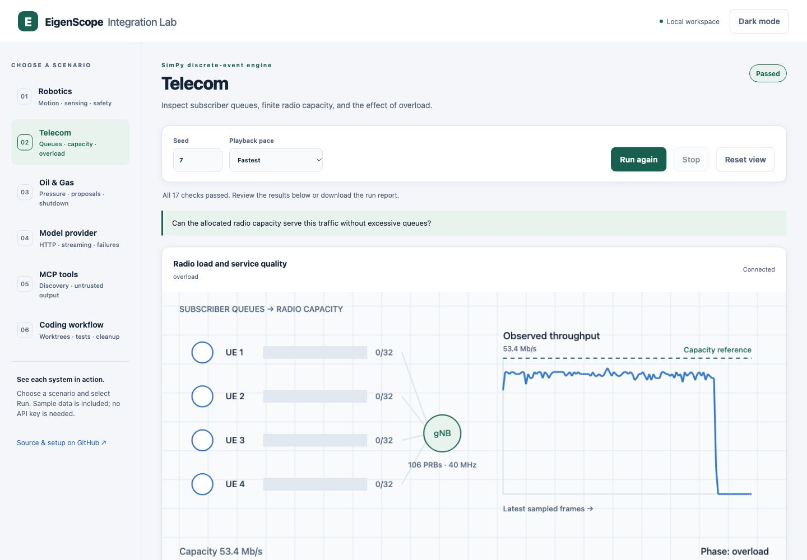

# EigenScope Integration Lab

[](https://github.com/LuckyOkoedion/eigenscope-integration-lab/actions/workflows/ci.yml)

An open-source companion to [EigenScope](https://eigenscope.guardianai.network/) for AI application developers, model providers and enterprise AI platform teams. Run industry scenarios, watch real simulator telemetry, connect the official SDK to your deployment, and validate model-runtime integration and inference latency.

[Explore EigenScope](https://eigenscope.guardianai.network/) · [Application guide](https://eigenscope.guardianai.network/guide/coding) · [Model platforms](https://eigenscope.guardianai.network/guide/model-platforms) · [Live SDK/API setup](docs/live-testing.md) · [Contributing](CONTRIBUTING.md)

## Start here

| Your next step | Where to go |
| --- | --- |
| Understand EigenScope and its use cases | Open the [workbench](https://eigenscope.guardianai.network/) and [product guide](https://eigenscope.guardianai.network/guide/agent-firewall) |
| Try the examples without an account or API key | [Run the local lab](#run-the-local-lab) and open its dashboard |
| Evaluate an SDK integration with your service | [Connect to EigenScope](#connect-to-eigenscope) using your authorized API access |
| Test automatic model profiles and inference latency | Follow the [model integration guide](docs/model-integration.md) with your checkpoints and SDK connector |
| Discuss a tailored deployment or industry pilot | Visit [Sponsored R&D](https://eigenscope.guardianai.network/sponsored-rd) or [contact Guardian AI](https://guardianai.network/contact) |

## Run the local lab

Install [Git](https://git-scm.com/downloads) and [uv](https://docs.astral.sh/uv/getting-started/installation/), then run these commands in a terminal:

```sh
git clone https://github.com/LuckyOkoedion/eigenscope-integration-lab.git
cd eigenscope-integration-lab
uv sync --locked --all-extras
uv run --frozen eigenscope-lab doctor
uv run --frozen eigenscope-lab serve
```

Open **http://127.0.0.1:8765**. Select a scenario, choose **Run**, and inspect its measurements and checks. Robotics shows movement, sensing and safety stops; Telecom shows queues and throughput; Oil & Gas shows receiver pressure, reviewed proposals and shutdown; the provider, MCP and coding views follow their actual protocol or process checkpoints. Switch between light and dark themes, stop a run, or download its completed JSON result. See the [dashboard guide](docs/visualization.md).

**Local scenarios and the dashboard need no EigenScope account, API key or hosted credits.** Installation downloads the pinned packages; these scenarios then run locally. The dashboard does not initiate authenticated API tests.

Python 3.12 is selected automatically. Python 3.11–3.13 are the initial CI targets. The default scenarios need no Docker daemon, GPU, radio hardware or physical robot. Git is used for the coding workflow. The installed Python SDK is an unmodified, hash-verified official package; [SDK versions and provenance](docs/sdk-snapshots.md) explain the reproducible baseline.



To run every local scenario from the terminal and save its results:

```sh
uv run --frozen eigenscope-lab run all --output results/local.json
```

## Choose a scenario

Run these commands from the repository directory. Each guide explains the setup, expected observations and integration boundary.

| Scenario | What executes | Command |
| --- | --- | --- |
| [Model provider](docs/scenarios/provider.md) | Official OpenAI client, local HTTP/SSE server, streaming and error controls | `uv run --frozen eigenscope-lab run provider` |
| [Coding workflow](docs/scenarios/coding.md) | Temporary Git repository/worktree and executable code checks | `uv run --frozen eigenscope-lab run coding` |
| [MCP tools](docs/scenarios/tools.md) | Official MCP SDK, subprocess transport and adversarial tool content | `uv run --frozen eigenscope-lab run tools` |
| [Telecom](docs/scenarios/telecom.md) | SimPy UE traffic, radio-resource budgets, finite queues and latency | `uv run --frozen eigenscope-lab run telecom` |
| [Robotics](docs/scenarios/robotics.md) | MuJoCo physics, navigation, sensing and an independent safety envelope | `uv run --frozen eigenscope-lab run robotics` |
| [Oil & Gas](docs/scenarios/oil-gas.md) | CoolProp methane properties, SciPy receiver dynamics and real OPC UA authorization checks | `uv run --frozen eigenscope-lab run oil-gas` |

Pair the lab examples with EigenScope's product blueprints: [coding agents](https://eigenscope.guardianai.network/guide/coding), [tool-result protection](https://eigenscope.guardianai.network/guide/tool-results), [telecom](https://eigenscope.guardianai.network/guide/telecom), [robotics](https://eigenscope.guardianai.network/guide/robotics), [Oil & Gas](https://eigenscope.guardianai.network/guide/oil-gas) and [model platforms](https://eigenscope.guardianai.network/guide/model-platforms).

The local lab exercises the external systems around EigenScope. Its `live` command separately calls the genuine SDK and configured service, then compares the observed results with the scenario's stated expectations. Read [architecture and fidelity](docs/architecture.md) for the exact components used in each tier.

For protocol-stack testing, the optional [native 5G tier](infra/telecom/README.md) runs actual Open5GS/UERANSIM registration and GTP-U traffic on a suitable Linux Docker host. Start with the portable Telecom scenario, then follow that tier's setup, verification and cleanup instructions.

## Connect to EigenScope

When you are ready to test the hosted service or your own sidecar:

1. Open [EigenScope Integrations](https://eigenscope.guardianai.network/integrations) for product-side SDK setup and API-access controls. The [official package registry](https://eigenscope.guardianai.network/registry) lists the vendor distributions. For deployment-specific access or a tailored pilot, use [Sponsored R&D](https://eigenscope.guardianai.network/sponsored-rd).
2. Follow the lab's [live SDK/API setup](docs/live-testing.md). Set `ORTHOCORE_API_KEY` through your shell or secret manager and choose the service origin you are authorized to test.
3. Run a selected case or the full synthetic workflow set:

```sh
export ORTHOCORE_BASE_URL=https://eigenscope.guardianai.network
# Set ORTHOCORE_API_KEY securely in your environment.
uv run --frozen eigenscope-lab live --case robotics --output results/robotics-live.json
uv run --frozen eigenscope-lab live --output results/live.json
```

Live testing submits the lab's published synthetic cases. It checks outbound content, task constraints, restoration and owned-mapping cleanup through the actual SDK/API. Local provider and industry components supply repeatable external behavior. Reports identify their versions and measurement boundaries. Keep credentials out of source files and result attachments.

TypeScript users can follow the [TypeScript quickstart](typescript/README.md), which includes installation, tests, explicit credential binding and the live command.

For exact-answer and explicitly private-context coverage beyond the sample workflows, run the optional [18-case challenge group](docs/live-testing.md#exact-answer-and-private-context-challenges):

```sh
uv run --frozen eigenscope-lab live --case challenges --output results/challenges.json
```

## Validate model-runtime integration

For teams operating their own models, the [model matrix runner](docs/model-integration.md) exercises real causal-model inference, automatic profile preparation and reuse through the SDK connector, and baseline versus integrated generation latency. Select your checkpoints, connect your deployment and inspect independent activation checks alongside p50/p95/p99 measurements.

Follow the guide to install the separate model environment, run the local GPT-2/Llama engine checks, and connect your actual models with the official `eigenscope_sdk.lab_connector:connect` adapter. Your application uses the same SDK's `connect_model(model)` entry point after the operator prepares its protected runtime. Model-inference dependencies stay out of the normal industry-scenario setup; private profiles stay in your protected runtime or private cache.

The [model-platform guide](https://eigenscope.guardianai.network/guide/model-platforms), [integration setup](https://eigenscope.guardianai.network/integrations#model-connection) and [Circuit Microscope](https://eigenscope.guardianai.network/circuits) connect the application, runtime and inspection paths. [Provider engineering](https://eigenscope.guardianai.network/sponsored-rd?vertical=MODEL_PROVIDERS_ENTERPRISE_AI&usecase=model-platforms) covers additional architectures, custom checkpoints, inference engines, hardware, private deployments and OEM integration.

## Read the results

Commands emit versioned JSON containing individual checks, dependency versions, seeds and measurements. Exit codes are **0 PASS**, **1 FAIL**, **2 BLOCKED/configuration**, and **3 test-runner ERROR**.

- **PASS:** the reported expectations passed for that scenario and environment.
- **FAIL:** inspect the named check and compare the observed behavior with its documented expectation.
- **BLOCKED:** resolve the missing dependency, configuration or runtime prerequisite, then rerun.
- **ERROR:** investigate the lab execution problem before interpreting the result as product behavior.

Physics time, simulated network latency, local provider time and hosted SDK wall time have separate meanings. The [live protocol](docs/live-testing.md) defines those boundaries. [Release verification](docs/verification.md) records supported platforms, executed checks and example results, including the optional native 5G tier.

Your generated files remain in the ignored `results/` directory. Review a report before sharing it and use synthetic reproductions for public issue reports.

## If you get stuck

| Situation | Next action |
| --- | --- |
| A package or prerequisite is missing | Run `uv sync --locked --all-extras`, then `uv run --frozen eigenscope-lab doctor` |
| Port 8765 is already in use | Run `uv run --frozen eigenscope-lab serve --port 8766` and open `http://127.0.0.1:8766` |
| An Intel macOS dependency needs Rust/OpenSSL build tools | Use the container option below, or install the required build tools and repeat setup |
| Live tests cannot start | Check the selected service origin and authorized API-key environment setup in the [live guide](docs/live-testing.md) |
| Native 5G setup fails | Follow the dedicated [Linux prerequisites and troubleshooting](infra/telecom/README.md) |

For a lab bug or proposed scenario, [open a GitHub issue](https://github.com/LuckyOkoedion/eigenscope-integration-lab/issues) with the command, platform, versions and sanitized result. For service access, deployment or partnership questions, [contact Guardian AI](https://guardianai.network/contact). Report vulnerabilities through the private process in [SECURITY.md](SECURITY.md).

## Container option

With a running Docker daemon, start the packaged dashboard from the repository directory:

```sh
docker compose up --build
# Colima users: docker --context colima compose up --build
```

Open **http://127.0.0.1:8765**. Stop it with `docker compose down` using the same Docker context. The container runs as a non-root user with a read-only filesystem, bounded temporary storage and a port published on host loopback. The optional native 5G stack has its own separate commands.

## Contribute

AI coding agents should start with [AGENTS.md](AGENTS.md). Read [CONTRIBUTING.md](CONTRIBUTING.md) to add an industry adapter, improve a scenario or contribute an adversarial regression case. The development checks are:

```sh
uv sync --locked --all-extras
uv run --frozen ruff check .
uv run --frozen ruff format --check .
uv run --frozen pytest
uv build
```

Dependencies retain their upstream licenses. See [third-party tools](THIRD_PARTY_NOTICES.md) and the lab's [Apache-2.0 license](LICENSE).
