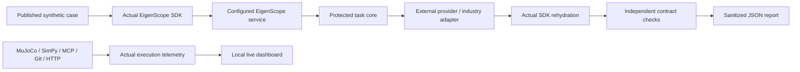

# Architecture and fidelity

## Two execution paths

`run` executes local external-system scenarios without calling EigenScope. These verify the industry engine, protocol boundary, control validation and failure controls. They do not measure EigenScope's separation effectiveness.

`live` invokes the official SDK against the configured actual service. A real OpenAI client sends the resulting protected core to the local deterministic provider; the official SDK restores the response and consumes the mapping. Independent expectations inspect privacy, retained task terms, untrusted directives and owned-ticket cleanup. Robotics/telecom adapters also exercise the returned core. Separate public workbench cases compare the actual workbench answer with independently stated arithmetic results.

## Fidelity table

| Boundary | Executed here | Additional deployment needed |
|---|---|---|
| Robotics | Actual MuJoCo state integration, ray sensing, contacts and controller constraints | A robot's calibrated dynamics, ROS2 transport and physical safety validation |
| Oil & Gas | CoolProp methane equation of state, SciPy receiver dynamics, independent shutdown and loopback OPC UA | Calibrated site/equipment model, operator identity and production transport security |
| Telecom fast scenario | Actual SimPy queue/resource simulation with seeded workload | Radio propagation/RF, actual E2AP/O-RAN controller and production scheduling |
| Telecom heavy profile | Pinned Open5GS core + UERANSIM RAN/UE when launched and verified | Suitable Linux container host, virtual-network capabilities; no physical RF |
| Provider | Actual OpenAI HTTP/SSE client and deterministic local endpoint | Actual model behavior, provider-network latency and commercial credentials |
| Tools | Actual official MCP stdio handshake and calls | A deployment's real tools, authorization and host configuration |
| Coding | Actual Git worktree and executable checks in temporary directories | A deployment's repository, CI permissions and IDE/proxy integration |

The lab never substitutes its own privacy engine for EigenScope. Protocol-wire fixtures in unit tests are explicitly synthetic and exercise client validation only.

## Event and report design

Engines emit measured state while running. The dashboard streams bounded events over SSE and keeps a limited run history. Optional pacing makes fast simulations readable while showing simulation and wall clocks separately. It is a diagnostic view, not a physical control surface.

The CLI emits versioned JSON with separate PASS/FAIL/BLOCKED/ERROR counts. Missing prerequisites cannot become passes. Runtime exceptions omit raw exception text to avoid accidentally publishing credentials. Reports use atomic file replacement.

## Dependency policy

`uv.lock` and the Node lockfile pin artifact integrity. Intel macOS uses MuJoCo 3.3.x, which supplies a compatible wheel; other platforms resolve the compatible current line recorded in the lockfile. Current cryptography may require Rust and OpenSSL to build on Intel macOS; do not substitute a vulnerable release to avoid compilation. Review platform constraints during dependency updates and run the security audit.
