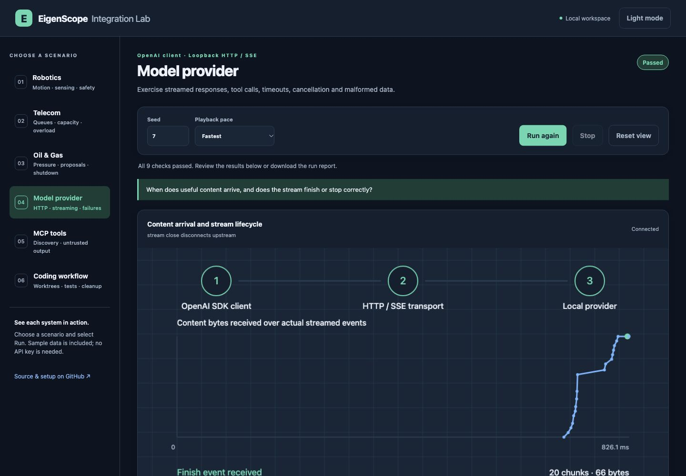
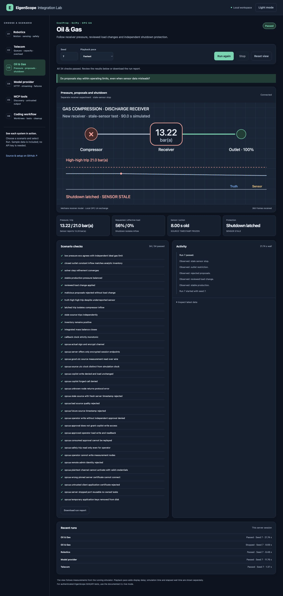

# Release verification

The lab is tested across supported Python platforms, Node.js and Docker. Each scenario checks an observable integration result and reports its dependency versions, seed, measurements and outcome.

## Automated checks

The [release CI run](https://github.com/LuckyOkoedion/eigenscope-integration-lab/actions/workflows/ci.yml) passed all seven jobs.

| Coverage | Result |
|---|---|
| Python 3.11, 3.12 and 3.13 on Linux | 254 tests per job; no failures, errors or skips |
| Python 3.12 on macOS and Windows | 254 tests per job; no failures, errors or skips |
| TypeScript on Node 24 | 26 tests, strict type checking and formatting passed |
| Six simulation scenarios | 88 checks passed on each Python platform and in Docker |
| Container dashboard | Non-root, read-only execution; HTTP state and packaged assets passed |
| Responsive layouts | Six views at 320, 390, 768 and 1440 CSS pixels, in both themes; document widths fit |

[Machine-readable test summary](verification/test-summary.json) · [Local scenario example](verification/local.json) · [Layout measurements](verification/responsive-checks.json)

The scenario checks cover MuJoCo motion, obstacle stops and sensor loss; SimPy queues, overload and allocation; OpenAI HTTP/SSE streaming and cancellation; MCP discovery and tool calls; temporary Git worktrees with executable tests; and methane receiver physics with encrypted OPC UA access, bounded approvals and independent shutdown.

## Native 5G stack

The optional [Open5GS/UERANSIM workflow](https://github.com/LuckyOkoedion/eigenscope-integration-lab/actions/workflows/native-5g.yml) passed five checks: UE status, registration, tunnel assignment, user-plane traffic and zero packet loss. Cleanup passed.

The tested versions are Open5GS **2.8.0-48-gf87da61**, UERANSIM **3.2.6** and MongoDB **7.0.45**, pinned by image digest. All three synthetic UE-to-UPF ICMP packets returned through the GTP-U tunnel, with an observed mean RTT of **0.612 ms**. This is a three-packet virtual-network observation.

[Native result and environment](verification/native-5g.json) · [Setup and troubleshooting](../infra/telecom/README.md)

## SDK/API testing

Run `eigenscope-lab live` to test your configured EigenScope service with the published sample cases. Python covers coding, tool output, telecom, robotics, Oil & Gas, email, Unicode and workbench controls; the TypeScript example covers coding, telecom, robotics and Oil & Gas. The result contains individual checks and timing fields.

The local simulator results above verify the lab's engines and integrations. Hosted-service results are generated separately for your selected SDK and deployment. Keep them in the ignored `results/` directory and review them before sharing. See [live testing](live-testing.md) and [SDK versions](sdk-snapshots.md).

## Dependencies and distribution

The [dependency audit](https://github.com/LuckyOkoedion/eigenscope-integration-lab/actions/workflows/dependencies.yml) reported zero known advisories among the indexed Python dependencies. Local/custom packages are outside that advisory index. The Node production dependency audit also reported zero known advisories. [Python audit](verification/dependency-audit.json) · [Node audit](verification/npm-audit.json)

The release wheel contains all three dashboard assets and the robot model. All 21 packaged source/asset files matched the source tree byte-for-byte; archive integrity and license inclusion passed. Release checksums identify the downloadable wheel and source archive.

## Dashboard examples

[Coding workflow, dark mode](verification/dashboard-coding-dark.jpg) · [MCP tools, light mode](verification/dashboard-tools-light.jpg) · [Mobile robotics, dark mode](verification/dashboard-robotics-mobile-dark.jpg) · [Mobile Oil & Gas, light mode](verification/dashboard-oil-gas-mobile-light.jpg)
